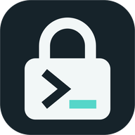
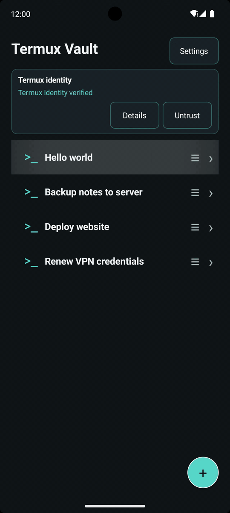
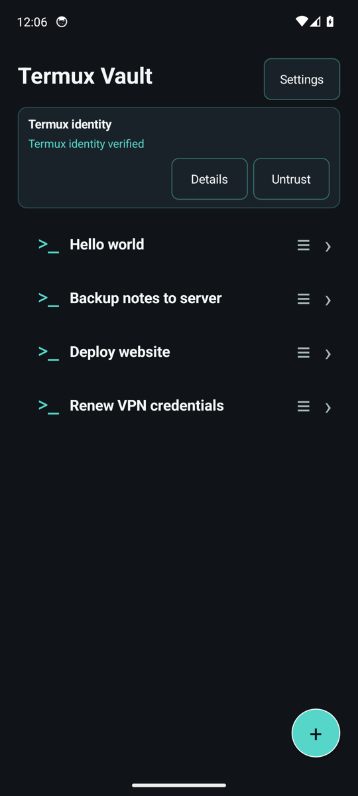
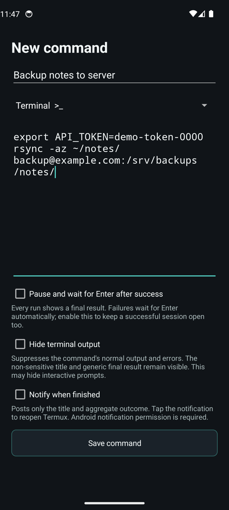
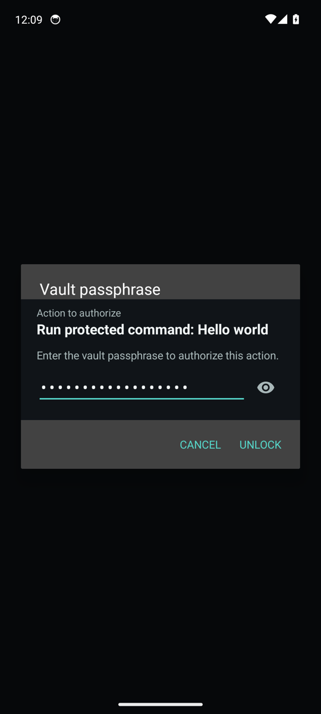
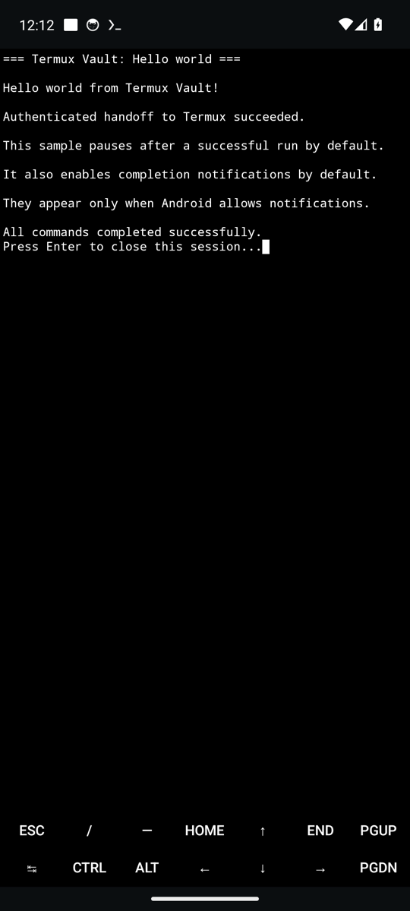
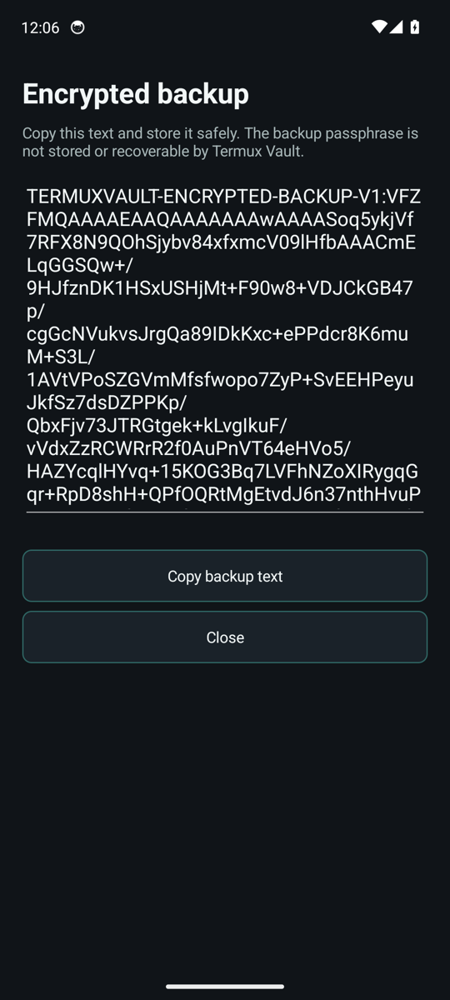
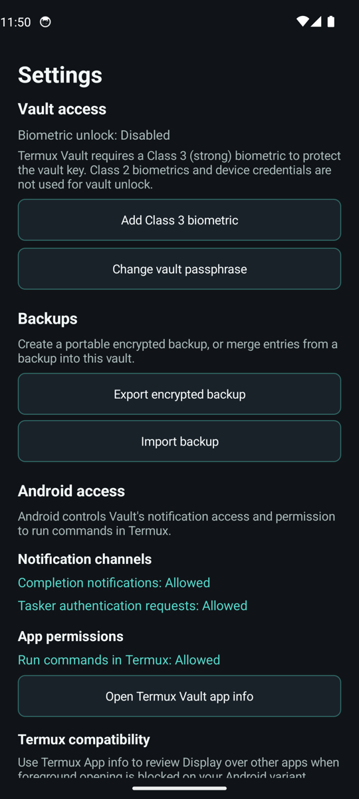
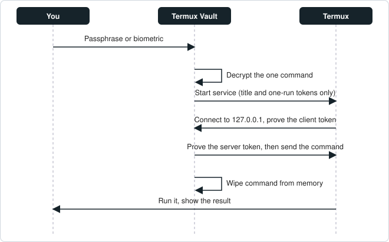

# <picture><source media="(prefers-color-scheme: dark)" srcset="docs/images/icon-dark.png"></picture> Termux Vault - Secure Command Launcher

Keep your sensitive Termux commands encrypted, and run them with one tap after you unlock.
Commands never sit in plain text on your phone.

 

*Not affiliated with or endorsed by the Termux project.*

[What it is](#what-it-is) · [Requirements](#requirements) · [Install](#install) · [First steps](#first-steps) · [Backups](#backups) · [Tasker](#tasker) · [Troubleshooting](#troubleshooting) · [Security](#security-at-a-glance) · [How it works](#how-it-works) · [License](#license)



*Tap a command, unlock with your fingerprint, and it runs in Termux.*

Also as a video: <a href="docs/demo/termux-vault-demo.mp4">MP4</a>

| Your commands | Edit a command | Unlock to run |
|:---:|:---:|:---:|
|  |  |  |

| It runs in Termux | Encrypted backup | Settings |
|:---:|:---:|:---:|
|  |  |  |

*The commands, server names and tokens in the screenshots and the demo are made-up examples (`example.com`, `demo-token-0000`). The vault in them was created for this page.*

## What it is

Some shell commands carry secrets: a token in a `curl` header, a password for a VPN, an `rsync`
line that points at your server. Shell history, notes apps and home-screen shortcuts all leave
those in clear text.

Termux Vault keeps each command encrypted with AES-256-GCM. To edit, delete or run one, you unlock
your vault (the encrypted list of your commands) with your passphrase, or with an optional strong
biometric. Termux Vault then hands the decrypted command straight to
[Termux](https://github.com/termux/termux-app) and wipes its own copy from memory.

## What you can do

- **Run on demand.** Tap an entry, unlock, and it runs in Termux.
- **See the result.** Every run ends with one clear line: all commands succeeded, or at least one
  failed (and on which line). Failures wait for you to press Enter.
- **Keep it open, or not.** For each command, choose to keep a successful session open, to be
  notified when it finishes, or to hide the command's output.
- **Reorder** your commands by dragging.
- **Add a widget** to your home screen, or let **Tasker** ask for a run. Both only ever show an
  authentication prompt. Nothing runs unattended.
- **Back up and restore** your whole vault as one line of encrypted text.

## Requirements

- Android 11 or newer.
- [Termux](https://github.com/termux/termux-app) installed in the same Android profile, from
  F-Droid or GitHub. Termux Vault checks its signing certificate before every run.
- In Termux, allow other apps to run commands:

  ```sh
  mkdir -p ~/.termux
  echo "allow-external-apps=true" >> ~/.termux/termux.properties
  termux-reload-settings
  ```

- Android permissions for notifications and **Run commands in Termux environment**. Termux Vault
  asks for both after you create your first vault.
- An optional Class 3 (`BIOMETRIC_STRONG`) fingerprint or face, only if you want biometric unlock.

If a run does not start, see [Troubleshooting](#troubleshooting).

## Install

Termux Vault is not on Google Play. Install it from one of these:

- **GitHub Releases**: download `TermuxVault-v<version>.apk` and check its signature (below).
- **F-Droid**: submission pending.

Release APKs are signed with the AndroidLabs key. Compare the certificate before you install:

```sh
apksigner verify --print-certs TermuxVault-v<version>.apk
```

> Signing certificate SHA-256:
> `e8503bc245fa92e4238dd741cbc6ec87d5bf945843d6248a1364ba3c880abc37`

## First steps

1. Open Termux Vault and choose a **vault passphrase**. There is no recovery if you forget it.
2. Tap **Trust** to approve the installed Termux's signing certificate.
3. Allow the two permissions Termux Vault asks for, and follow the short Termux preparation guide.
4. Tap **Hello world**, unlock, and watch it run in Termux.
5. Tap **+** to add your own commands.

## Backups

**Settings → Export encrypted backup** produces a single line starting with
`TERMUXVAULT-ENCRYPTED-BACKUP-V1:`. It is encrypted with its own Argon2id-derived key, so you can
use your vault passphrase or a separate one. Import merges the entries into your vault and never
changes or removes what is already there. Termux Vault never writes a backup to a file. It only
copies text when you press **Copy**.

A plaintext JSON export exists in the Danger zone for people who need an editable file. It is not
encrypted, so treat it accordingly.

## Tasker

Long-press an entry and choose **Tasker ID**. In Tasker, add a **Send Intent** action:

| Field   | Value                                     |
| ------- | ----------------------------------------- |
| Action  | `org.androidlabs.termuxvault.RUN_ENTRY`   |
| Package | `org.androidlabs.termuxvault`             |
| Extra   | `entry_id:<the UUID shown in the dialog>` |
| Target  | Broadcast Receiver                        |

Termux Vault answers with a notification. Tap it and unlock to run. Tasker can request a run but
never decrypts or executes anything by itself.

## Troubleshooting

**"Command not run: Termux did not complete the one-time handoff within 12 seconds."**
Termux did not accept the command in time. Check these, then try again:

1. `allow-external-apps=true` is in `~/.termux/termux.properties` (see
   [Requirements](#requirements)). After editing it, run `termux-reload-settings`, or force-stop
   Termux and open it again so it re-reads the file.
2. Termux Vault has the **Run commands in Termux environment** permission. Settings shows its state.
3. If Termux did not come to the front, enable **Display over other apps** for Termux in Android's
   app settings. A very slow first start of Termux can also exceed the 12 seconds.

**"Termux identity is no longer trusted."** Termux was replaced by a build with a different
signing certificate. Review the certificate on the main screen and tap **Trust** if it is the
Termux you intend to use.

**No completion or Tasker notification.** Allow notifications for Termux Vault in Android settings.
Settings lists the state of both notification channels, with a shortcut to fix a disabled one.

**Biometric unlock says "reset required".** Android invalidates the key when your enrolled
biometrics change. Reset biometric unlock in Settings (it asks for your passphrase) and add it
again. Your passphrase always keeps working.

## Security at a glance

Your commands are encrypted with per-command AES-256-GCM keys, wrapped by a vault key, which is
wrapped by your passphrase through **Argon2id** (64 MiB, 3 passes, 4 lanes). Changing the
passphrase creates a new vault key and re-wraps everything. Optional biometric unlock uses a
non-exportable Android Keystore key that accepts only Class 3 biometrics, never a device PIN or
pattern.

| Protects against | Does not protect against |
|---|---|
| Anyone who gets your vault file or a backup: commands are ciphertext | A compromised phone, root access or a debugger |
| Other apps reading commands from Intents, process arguments, files, the cache, shell history or logs | A malicious or modified Termux build that you chose to trust |
| Unattended runs: widgets and Tasker only show an authentication prompt | A keyboard or accessibility service you have enabled; it can see what you type and read |
| Screenshots, overlays and tap-jacking over sensitive screens | What your command itself reveals: its output, files, network requests or child-process arguments |
| Running a different Termux: its signing certificate is checked before every run | A weak passphrase: Argon2id slows guessing but cannot make it safe |
| Wrong keys after a passphrase change: an old vault file plus the old passphrase fails | Text you copy or export yourself, such as the clipboard or the plaintext JSON export |

Titles, icons, order and your pause, notification and output choices are stored unencrypted. Only
the commands themselves are encrypted. Any non-empty passphrase is accepted, and a weak one only
triggers a warning. See [SECURITY.md](SECURITY.md) for the full model.

## How it works

1. You unlock your vault. The passphrase goes through Argon2id and unwraps the vault key.
2. Termux Vault checks that the installed Termux still has the signing certificate you trusted.
3. Termux Vault opens a one-time listener on `127.0.0.1` and starts Termux with only a fixed
   bootstrap, two random one-run tokens and the command's title. **The command itself is not in
   the Intent.**
4. Termux and Termux Vault prove to each other that they hold the tokens. Only then does Termux
   Vault send the command, through memory and an anonymous pipe, never through a file, argument or
   environment variable.
5. Termux Vault wipes its copy. The whole exchange has a strict 12-second deadline.



## Contributing and building

Build instructions, tests and release signing are in [CONTRIBUTING.md](CONTRIBUTING.md).

## Security reports

Please do **not** open a public issue for a vulnerability. See [SECURITY.md](SECURITY.md).

## License

[GPL-3.0-only](LICENSE). Third-party components keep their own licenses, including Bouncy Castle
(MIT-style), which ships inside the APK.
